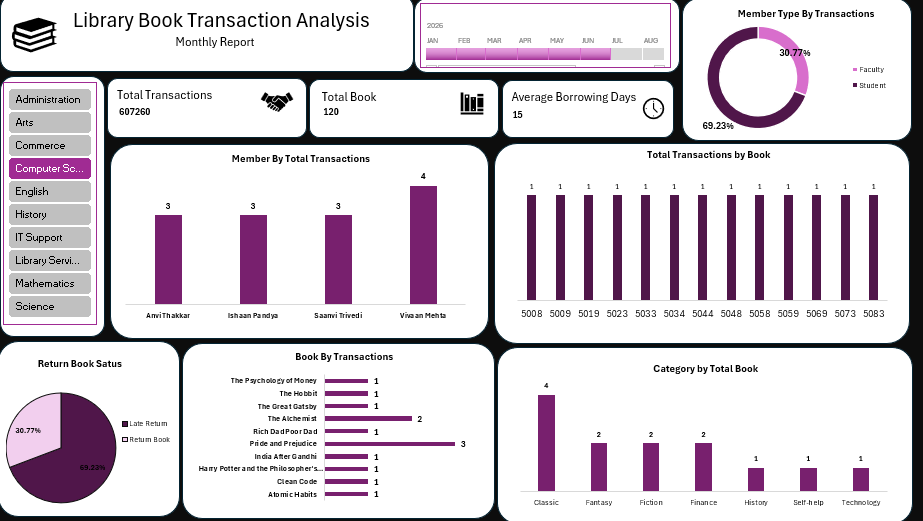

# 📚 Library Book Transaction Analysis & Dashboard

> *An Excel-based project focused on library book transactions, borrowing patterns, book-category performance, member activity, return status, and interactive dashboard reporting.*

---

## 📋 Table of Contents

- [📌 Project Overview](#-project-overview)
- [🎯 Project Objective](#-project-objective)
- [✨ Key Features](#-key-features)
- [📚 Analysis & Excel Practice](#-analysis--excel-practice)
- [🔄 From Raw Data to Library Insights](#-from-raw-data-to-library-insights)
- [📊 Dashboard Preview](#-dashboard-preview)
- [🔍 Key Insights](#-key-insights)
- [🛠️ Tools & Techniques](#️-tools--techniques)
- [🚀 Future Improvements](#-future-improvements)
- [👤 Author](#-author)

---

## 📌 Project Overview

This project uses **Microsoft Excel** to analyze library book transactions, borrowing trends, book-category performance, member activity, and return status.

It combines Excel formulas, transaction filtering, PivotTables, charts, KPI cards, slicers, and a timeline to turn library transaction records into meaningful insights through an interactive dashboard.

## 🎯 Project Objective

- Analyze library book borrowing patterns over time.
- Identify frequently borrowed books and popular categories.
- Compare member activity by member type and department.
- Monitor return status, including late returns.
- Practice Excel data analysis and interactive reporting.
- Build an interactive dashboard for library reporting and storytelling.

## ✨ Key Features

- Date and month-based transaction analysis
- Filtering transactions by author and transaction ID
- Transaction detail lookup
- Return-status analysis
- Monthly transaction trends and growth indicators
- Member and book comparisons
- Category-wise transaction analysis
- PivotTables and PivotCharts
- KPI cards, slicers, and timeline
- Interactive dashboard for exploring library activity

## 📚 Analysis & Excel Practice

### 1. 📅 Date & Time Analysis

Used issue dates, due dates, return dates, and month fields to review borrowing periods and monthly transaction trends.

### 2. 🔎 Filtering & Transaction Lookup

Used selection controls to filter books by author and look up individual transactions using transaction IDs.

### 3. 📈 Borrowing & Return Analysis

Reviewed borrowing days and return status to distinguish regular returns from late returns.

### 4. 📚 Book & Category Analysis

Compared transaction counts by book title and category to identify frequently borrowed books and popular categories.

### 5. 👥 Member Analysis

Compared transaction activity by member name, member type, and department.

### 6. 📊 PivotTables & Charts

Created summary tables and charts to present monthly trends, member activity, book transactions, category totals, and return-status distribution.

### 7. 📈 Dashboard & Storytelling

Combined KPI cards, a monthly timeline, department filters, member-type distribution, member transaction counts, book-level transaction counts, return status, and category comparisons in one dashboard.

## 🔄 From Raw Data to Library Insights

This project follows a structured workflow to transform library transaction data into useful reporting.

| Step | Process | Purpose |
|---|---|---|
| 01 | Raw Data | Explore library transaction records |
| 02 | Formula Analysis | Calculate borrowing days and transaction metrics |
| 03 | Transaction Review | Review return status and transaction details |
| 04 | PivotTables & Charts | Summarize book, member, and category activity |
| 05 | Interactive Dashboard | Present KPIs, charts, slicers, and a timeline |
| 06 | Library Insights | Communicate borrowing patterns and return trends |

## 📊 Dashboard Preview

## 🔍 Key Insights

The dashboard helps analyze:

- **Total Transactions:** Number of recorded book transactions.
- **Total Books:** Number of books represented in the dashboard.
- **Average Borrowing Days:** Average number of days recorded for borrowing.
- **Member Type by Transactions:** Transaction distribution by member type.
- **Member by Total Transactions:** Members with the highest transaction counts.
- **Total Transactions by Book:** Transaction counts for individual books.
- **Book by Transactions:** Frequently borrowed book titles.
- **Category by Total Book:** Transaction totals across book categories.
- **Return Book Status:** Distribution of return statuses, including late returns.

*Dashboard values may change when filters or the timeline are applied.*

## 🛠️ Tools & Techniques

| Tool / Technique | Purpose |
|---|---|
| Microsoft Excel | Data analysis and dashboard creation |
| Excel Formulas | Calculate borrowing days, dates, and transaction metrics |
| Filters and Selection Controls | Explore records by author, department, or transaction ID |
| PivotTables & PivotCharts | Summarize and visualize transaction data |
| Charts | Compare monthly, member, book, category, and return-status patterns |
| Conditional Formatting | Highlight changes and performance indicators |
| Slicers & Timeline | Interactively filter dashboard views |

## 🚀 Future Improvements

- Add more member and book-level comparisons.
- Include overdue duration and fine analysis if those fields are available.
- Add monthly and year-over-year trend comparisons.
- Improve KPI comparisons and dashboard navigation.
- Explore forecasting of borrowing demand.
- Connect the dataset to Power BI for advanced reporting.

## 👤 Author

### **Himanshi Sangani**

🎓 Bachelor of Computer Applications (BCA)
